

  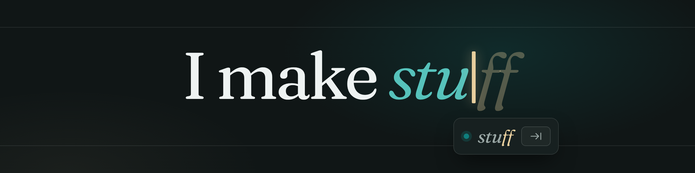

  <b>Founder at QoutPlus · Co-founder at Tasheel Tech · Full-stack developer</b> 
  I build the software restaurants, retailers and clinics run on every day, from idea to a self-hosted production system.

  
  
  
  

<i>Press Tab to accept. I usually do.</i>

<table align="center">
  <tr>
    <td align="center"> <b>Founder</b> QoutPlus · 2023</td>
    <td align="center"> <b>Co-founder</b> Tasheel Tech · 2026</td>
    <td align="center"> <b>2M+ views a month</b> on RF4 Trophies</td>
    <td align="center"> <b>Oran, Algeria</b> since Dec 2024</td>
    <td align="center"> <b>Arabic & English</b> both, daily</td>
  </tr>
</table>

<picture><source media="(prefers-color-scheme: light)" srcset="assets/cards/h-work-light.png">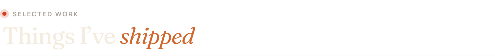</picture>

  <a href="https://abdulhkim.com/work/rf4-trophies/"><picture><source media="(prefers-color-scheme: light)" srcset="assets/cards/rf4-light.png">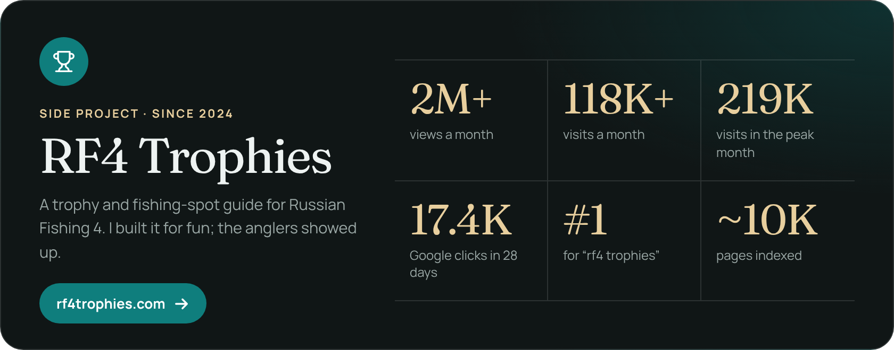</picture></a>

  <a href="https://abdulhkim.com/work/menupasha/"><picture><source media="(prefers-color-scheme: light)" srcset="assets/cards/menupasha-light.png">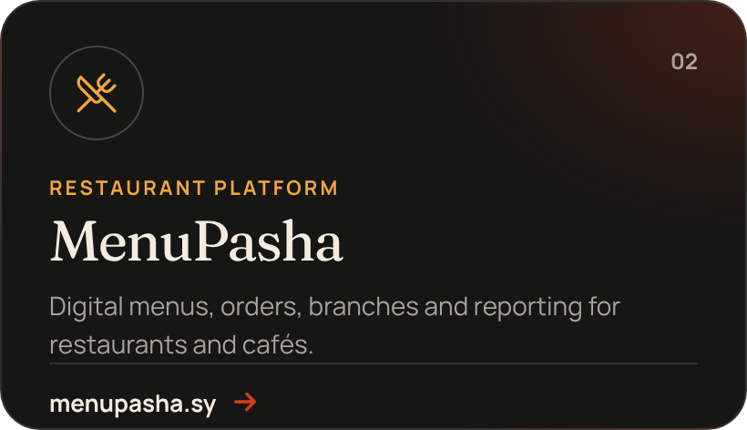</picture></a>
  <a href="https://abdulhkim.com/work/autozatca/"><picture><source media="(prefers-color-scheme: light)" srcset="assets/cards/autozatca-light.png">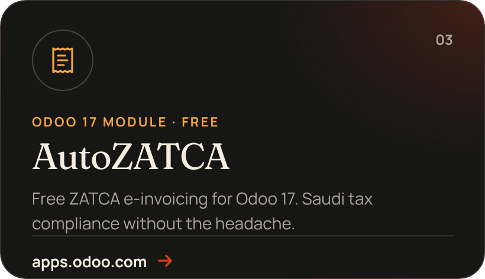</picture></a>

  <a href="https://abdulhkim.com/work/tabibon/"><picture><source media="(prefers-color-scheme: light)" srcset="assets/cards/tabibon-light.png">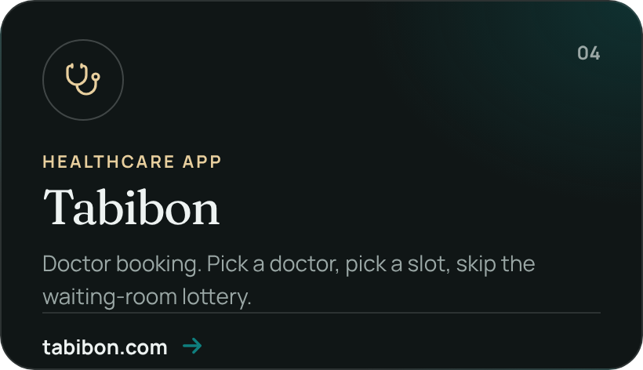</picture></a>
  <a href="https://abdulhkim.com/work/shariii/"><picture><source media="(prefers-color-scheme: light)" srcset="assets/cards/shariii-light.png">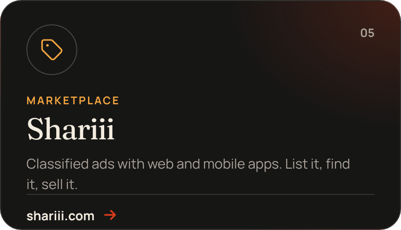</picture></a>

  <a href="https://abdulhkim.com/work/tadbeer/"><picture><source media="(prefers-color-scheme: light)" srcset="assets/cards/tadbeer-light.png">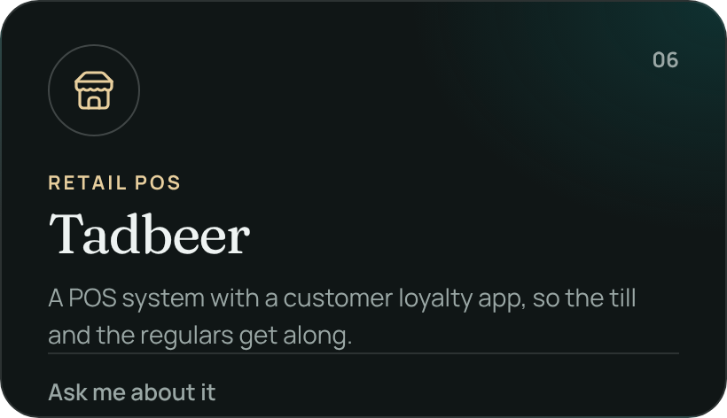</picture></a>
  <a href="https://abdulhkim.com/work/custom-crm-erp/"><picture><source media="(prefers-color-scheme: light)" srcset="assets/cards/systems-light.png">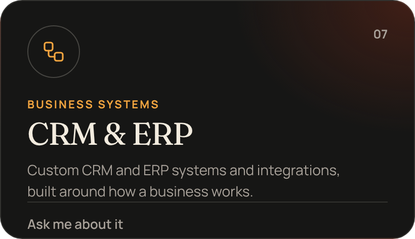</picture></a>

<a href="https://abdulhkim.com/work/"><b>See every project on abdulhkim.com →</b></a>

<picture><source media="(prefers-color-scheme: light)" srcset="assets/cards/h-services-light.png"></picture>

<picture><source media="(prefers-color-scheme: light)" srcset="assets/cards/services-light.png">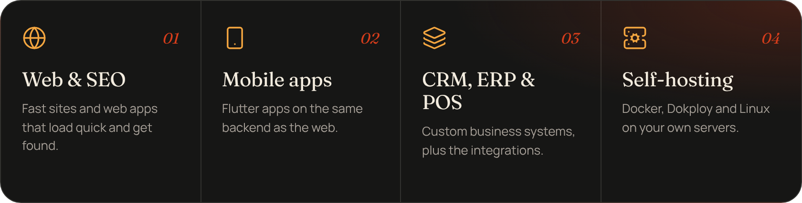</picture>

<picture><source media="(prefers-color-scheme: light)" srcset="assets/cards/h-companies-light.png"></picture>

| | Role | Company | When |
|:-:|---|---|---|
|  | **Co-founder** | [**Tasheel Tech**](https://tasheeltech.sy): a digital product studio for websites, mobile apps and business systems | Apr 2026 – now |
|  | **Founder** | [**QoutPlus**](https://qoutplus.com): web design and development, SEO, apps and ad management | Mar 2023 – now |
|  | **Creator** | [**RF4 Trophies**](https://rf4trophies.com): the Russian Fishing 4 trophy guide above, 2M+ views a month | Aug 2024 – now |
|  | **IT Manager** (part-time) | [**CNR WOOD**](https://cnrwood.com): built automation tools and migrated the production software | Jul 2021 – Nov 2024 |

<picture><source media="(prefers-color-scheme: light)" srcset="assets/cards/h-stack-light.png"></picture>

  

  
  
  

<picture><source media="(prefers-color-scheme: light)" srcset="assets/cards/h-activity-light.png">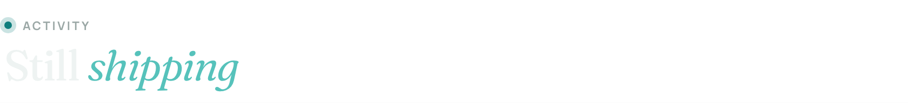</picture>

  <picture>
    <source media="(prefers-color-scheme: light)" srcset="https://raw.githubusercontent.com/blackice2412/blackice2412/output/snake-light.svg">
    
  </picture>

<picture><source media="(prefers-color-scheme: light)" srcset="assets/cards/h-contact-light.png">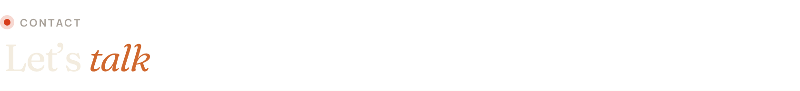</picture>

  Got an idea, a messy spreadsheet or a system that needs replacing?  
  
  
  

  

Made by me, obviously. Cards are rendered by <a href="scripts/cards.mjs">scripts/cards.mjs</a>.

